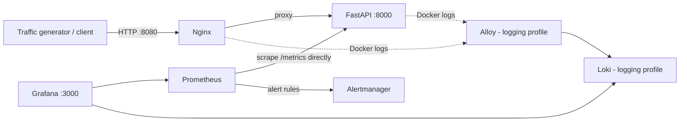
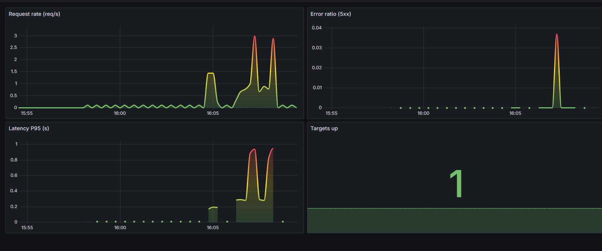
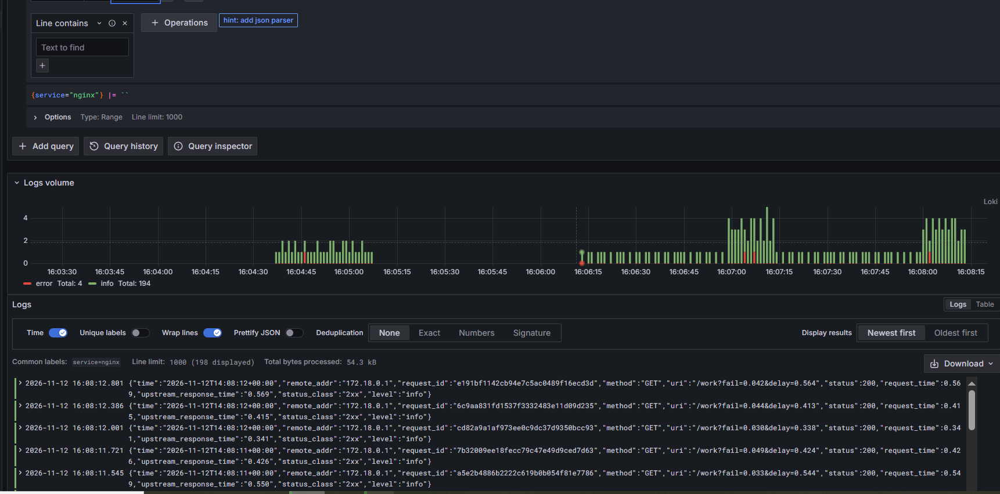

# SRE Monitoring Lab

[](https://github.com/daviamarall/observability-lab/actions/workflows/ci.yml)


A local observability lab for exploring core SRE workflows: instrument a service,
generate traffic and failures, inspect metrics and logs, and route alerts.
The default stack runs with Docker Compose; centralized logging is available
when you enable the optional `logging` profile.

## What is included

- **FastAPI** demo service with Prometheus metrics and structured JSON logs.
- **Nginx** reverse proxy with JSON access logs and request-ID propagation.
- **Prometheus** metrics collection and SLI alert rules.
- **Alertmanager** alert grouping and routing.
- **Grafana** dashboard provisioned from JSON.
- Optional **Grafana Loki** log storage and **Grafana Alloy** Docker-log collection.
- An interactive traffic and chaos simulator that uses only Python's standard
  library.

## Architecture



Prometheus scrapes the app directly at `app:8000`; metrics do not pass through
Nginx. Loki and Alloy start only with the `logging` profile.

## Start the lab

### Default stack

```bash
docker compose up --build -d
```

### Full stack with centralized logs

```bash
docker compose --profile logging up --build -d
curl -fsS http://localhost:3100/ready
```

The readiness check is optional; when Loki is ready it returns `ready`.

| Component | URL | Notes |
|---|---|---|
| FastAPI app | <http://localhost:8000> | Direct app access and `/metrics` |
| Nginx proxy | <http://localhost:8080> | Recommended entry point for generated traffic |
| Prometheus | <http://localhost:9090> | Metrics, targets, and alert states |
| Alertmanager | <http://localhost:9093> | Active alerts and notification handling |
| Grafana | <http://localhost:3000> | Dashboard and Explore; default lab login: `admin` / `admin` |
| Loki | <http://localhost:3100> | Optional; enabled with the `logging` profile |

Open the **SRE — SLI/SLO Overview** dashboard in Grafana. Its panels use
threshold-based colors and a smooth, filled time-series style. The dashboard
refreshes every second; request rate, error ratio, and P95 visualization use
10-second rolling windows. Panel colors are visual thresholds, not alert rules.



## Generate traffic

The `./simulate` wrapper calls `scripts/traffic_generator.py`. It sends traffic
to the local Nginx endpoint at `http://localhost:8080/work`, prints live
request and status-code counts, and requires no third-party Python packages.

```bash
./simulate normal
./simulate chaos
./simulate slo-spike
./simulate latency
./simulate realistic
```

| Mode | Behavior | Default run time |
|---|---|---|
| `normal` | Low-rate traffic; 1% simulated failure probability and 50–150 ms delay | Until `Ctrl+C` |
| `chaos` / `slo-spike` | 16 concurrent workers; 90% simulated failure probability | 30 seconds |
| `latency` | 4 workers; 1.5–3 second response delays | Until `Ctrl+C` |
| `realistic` | Continuous traffic alternating lower-traffic and peak periods, with occasional errors | Until `Ctrl+C` |

Stop continuous modes with `Ctrl+C`. Set an optional duration (up to 600
seconds) or worker count (1–32):

```bash
./simulate normal --duration 60
./simulate latency --duration 600 --workers 8
./simulate chaos --duration 30 --workers 16
```

Alert rules include rolling windows and pending durations, so an alert may not
fire as soon as a simulator starts. See the rule table below and
[`docs/SLI-SLO.md`](docs/SLI-SLO.md).

## Metrics and alerts

Prometheus scrapes targets and evaluates rules every second. Application metrics
are exposed at <http://localhost:8000/metrics>.

| Alert | Condition | Pending duration |
|---|---|---:|
| `HighErrorRate` | 5xx rate above 5%, calculated over 1 minute | 30 seconds |
| `HighLatencyP95` | P95 latency above 300 ms, calculated over 5 minutes | 5 minutes |
| `AppDown` | Prometheus cannot scrape the application target | 1 minute |

Inspect alert states at <http://localhost:9090/alerts>. Alertmanager receives
firing and resolved alerts from Prometheus; it handles notification grouping
and routing rather than defining these Prometheus rules.

SLI/SLO targets, error-budget definitions, and the alert policy are documented
in [`docs/SLI-SLO.md`](docs/SLI-SLO.md). Incident response steps are in
[`docs/RUNBOOK.md`](docs/RUNBOOK.md).

## Centralized logs (optional)

Start the full stack with the `logging` profile, then open **Grafana → Explore**
and select the **Loki** data source. To see all collected application and Nginx
logs:

```logql
{service=~"app|nginx"}
```

### Useful LogQL queries

Application errors with their exception stack traces:

```logql
{service="app", level="error"} | json | exception != "" | line_format "{{.exception}}"
```

Nginx 5xx logs:

```logql
{service="nginx", status_class="5xx"} | json
```

Nginx 5xx rate per second over the last minute:

```logql
sum(rate({service="nginx"} | json | status_class="5xx" [1m]))
```

P95 Nginx request duration in seconds:

```logql
quantile_over_time(0.95, {service="nginx"} | json | unwrap request_time | __error__="" [5m])
```

To follow one request across both services, get its `X-Request-ID` response
header and filter by that ID:

```logql
{service=~"app|nginx"} | json | request_id="PASTE_REQUEST_ID_HERE"
```

Alloy collects Docker logs from the **app** and **Nginx** containers, drops
`/healthz` and `/metrics` entries, and sends the remaining logs to Loki. Indexed
labels are limited to `service`, `level`, and `status_class`; paths, IPs,
request IDs, and latency remain in each JSON log line. Loki retains logs for
7 days in the named `loki-data` Docker volume. Docker also retains rotated
container logs (10 MB per file, 3 files for app and Nginx).



More startup and query examples are available in [`docs/LOGGING.md`](docs/LOGGING.md).

## Application endpoints

| Method | Path | Purpose |
|---|---|---|
| `GET` | `/` | Service metadata |
| `GET` | `/healthz` | Liveness probe |
| `GET` | `/work?fail=0..1&delay=<seconds>` | Simulated work, failures, and latency |
| `GET` | `/metrics` | Prometheus metrics exposition |

Requests through Nginx receive an `X-Request-ID`; the same ID is included in
the app and Nginx logs.

## Configuration and project layout

```text
.
├── alloy/config.alloy                 # Optional Docker log collection pipeline
├── alertmanager/alertmanager.yml      # Alert routing configuration
├── app/
│   ├── src/app/main.py                # FastAPI app, metrics, and JSON logs
│   └── tests/                         # App tests
├── docs/
│   ├── LOGGING.md                     # Loki/LogQL guide
│   ├── RUNBOOK.md                     # Alert response procedures
│   ├── SLI-SLO.md                     # SLI/SLO and error-budget definitions
│   └── images/                        # Dashboard screenshot
├── grafana/
│   ├── dashboards/                    # Provisioned dashboard JSON
│   └── provisioning/datasources/      # Prometheus and Loki data sources
├── images/image.png                   # Loki Explore screenshot for this README
├── loki/loki.yml                      # Loki 3.x, filesystem, 7-day retention
├── nginx/nginx.conf                   # Proxy and JSON access-log format
├── prometheus/
│   ├── alerts.yml                     # Recording and alerting rules
│   └── prometheus.yml                 # Scrape and evaluation intervals
├── scripts/traffic_generator.py       # Traffic and chaos simulator
├── simulate                           # Short CLI wrapper
└── docker-compose.yml                 # Default stack and optional logging profile
```

Most thresholds and dashboard settings are managed as code in the files above.
Grafana dashboards and data sources are provisioned from the repository, while
Prometheus alert rules are evaluated from `prometheus/alerts.yml`.

## Tests and shutdown

Run the application tests:

```bash
cd app
python -m pytest -q
```

Stop the containers while keeping persisted data:

```bash
docker compose --profile logging down
```

## Further reading

- [SLI/SLO definitions](docs/SLI-SLO.md)
- [Incident response runbook](docs/RUNBOOK.md)
- [Centralized logging guide](docs/LOGGING.md)
- [Contributing](CONTRIBUTING.md)
- [Security policy](SECURITY.md)

## License

MIT — see [LICENSE](LICENSE).
