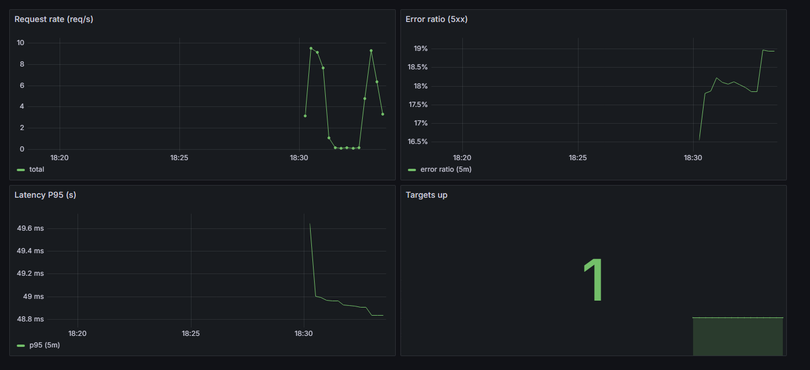

# sre-monitoring-lab

[](https://github.com/daviamarall/observability-lab/actions/workflows/ci.yml)


A complete, from-scratch **observability** stack that runs with a single `docker compose up`. It demonstrates core **SRE** fundamentals: measuring, alerting, and responding based on **SLIs/SLOs**.

> A portfolio project focused on **SRE / DevOps**. Its emphasis is the **telemetry data pipeline** and the **operational discipline** built around it.

---

## 🎯 What This Repository Demonstrates

- **Instrumentation** of an application using `prometheus_client` (Counter, Histogram, Gauge)
- **Metrics collection** with Prometheus (scrape configuration, retention)
- **Alerting** with Alertmanager (routing, grouping, silencing)
- **SLI/SLO-based alert rules** (error rate and P95 latency)
- **Dashboards as code**, automatically provisioned in Grafana
- **Formal SLI/SLO definitions with error budgets** (see [`docs/SLI-SLO.md`](docs/SLI-SLO.md))
- **Incident response runbook** (see [`docs/RUNBOOK.md`](docs/RUNBOOK.md))
- A fully reproducible environment via Docker Compose

## 🏗️ Architecture

```
                    ┌──────────────────────────────────────────────┐
                    │              docker compose                  │
                    │                                              │
  curl /work ─────▶ │  ┌────────┐   scrape   ┌────────────┐        │
                    │  │  app   │◀───────────│ Prometheus │        │
                    │  │ :8000  │  /metrics  │   :9090    │        │
                    │  └────────┘            └─────┬──────┘        │
                    │                              │ evaluates     │
                    │                              │ rules         │
                    │                              ▼               │
                    │                        ┌──────────────┐      │
                    │                        │ Alertmanager │      │
                    │                        │    :9093     │      │
                    │                        └──────────────┘      │
                    │                                              │
                    │  ┌──────────┐   query    ┌────────────┐      │
                    │  │ Grafana  │◀───────────│ Prometheus │      │
                    │  │  :3000   │            └────────────┘      │
                    │  └──────────┘                                │
                    └──────────────────────────────────────────────┘
```

## 📊 Dashboard (Grafana)

The dashboard is provisioned **as code** and visualizes the service's SLIs: request rate, 5xx error rate, P95 latency, and target availability.



## 🚀 Getting Started

```bash
docker compose up --build
```

| Service        | URL                   | Credentials |
|----------------|-----------------------|-------------|
| API + /metrics | http://localhost:8000 | —           |
| Prometheus     | http://localhost:9090 | —           |
| Alertmanager   | http://localhost:9093 | —           |
| Grafana        | http://localhost:3000 | admin/admin |

### Generating Traffic (to see live graphs)

The following sends 200 requests with a simulated ~15% failure rate and ~120 ms latency.

**Linux / macOS (bash):**

```bash
for i in $(seq 1 200); do
  curl -s "http://localhost:8000/work?fail=0.15&delay=0.12" > /dev/null
done
```

**Windows (PowerShell):**

```powershell
for ($i=0; $i -lt 200; $i++) { curl "http://localhost:8000/work?fail=0.15&delay=0.12" }
```

## 🔌 Application Endpoints

| Method | Route      | Description                                                    |
|--------|------------|----------------------------------------------------------------|
| GET    | `/`        | Service metadata                                               |
| GET    | `/healthz` | Liveness probe                                                 |
| GET    | `/work`    | Simulates work; supports `?fail=0..1` and `?delay=<seconds>`   |
| GET    | `/metrics` | Metrics in Prometheus format                                   |

## 📈 SLI / SLO Summary

| SLI                          | SLO Target | Error Budget (30 days) |
|------------------------------|------------|------------------------|
| Availability (2xx rate)      | 99.9%      | 43m 12s                |
| Latency (P95)                | < 300 ms   | 5% of time windows     |

See [`docs/SLI-SLO.md`](docs/SLI-SLO.md) for full details.

## 🚨 Configured Alerts

| Alert            | Condition                       | Severity |
|------------------|---------------------------------|----------|
| `HighErrorRate`  | 5xx rate > 5% for 30 seconds    | critical |
| `HighLatencyP95` | P95 latency > 0.3s for 5 minutes| warning  |
| `AppDown`        | `up == 0` for 1 minute          | critical |

For local demos, Prometheus scrapes and evaluates rules every second, and the
dashboard refreshes every second with 10-second rolling metrics. The
`HighErrorRate` alert retains a 1-minute rolling error-rate window.

## 📁 Project Structure

```
observability-lab/
├── app/                     # Instrumented application (FastAPI + prometheus_client)
├── prometheus/              # prometheus.yml + alerts.yml (SLO rules)
├── alertmanager/            # alertmanager.yml (routing)
├── grafana/                 # Datasource + dashboard provisioning (as code)
├── docs/                    # SLI-SLO.md and RUNBOOK.md
└── docker-compose.yml
```

## 🛠️ Tech Stack

Python · FastAPI · prometheus_client · Prometheus · Alertmanager · Grafana · Docker Compose

## 📄 License

MIT — see [LICENSE](LICENSE).